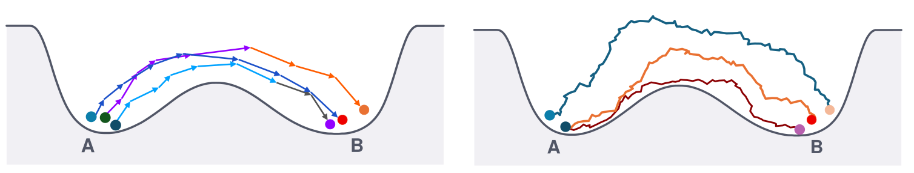

# Action Learning for Scientific Simulations

#### [[Paper]](https://arxiv.org/abs/2610.31585v1) [[Project page]](https://sarahliaw.github.io/action-learning/)

[Sarah Liaw](https://sarahliaw.github.io/), [Yuanqi Du](https://yuanqidu.github.io/), [Yilun Du](https://yilundu.github.io/)

LEAP (Learned Energy on Action Paths) learns the action of a stochastic system, a differentiable cost on whole
trajectories, directly from trajectory samples.

LEAP anchors the unknown action to a simple reference process whose action we can write down. It learns the rest by
telling observed paths apart from reference paths.

We then reuse the learned action to rank paths, infer representative transitions, steer mechanisms and add
constraints, with no retraining.

<p align="center">
  
</p>
<p align="center"><sub>Local models chain one step transitions into a likelihood over paths (left). LEAP compares
whole paths and learns their relative cost (right).</sub></p>

## Setup

Run `uv sync` to create the environment and `source .venv/bin/activate` to enter it.

The alanine dipeptide experiment also needs OpenMM for its simulations and geometry check, so set it up with
`uv sync --extra md`.

## Quick start

To check the setup, run the tests and a small double well example on a CPU.

```bash
pytest
python -m experiments.double_well.run --config configs/double_well/smoke.json --out results/smoke
```

## Using LEAP on your own system

You bring observed paths, a reference process you can sample and evaluate, and a network that scores whole paths.

[`examples/custom_system.py`](examples/custom_system.py) puts these together on a toy double well. It learns the drift
from the paths alone and then uses the learned action to find the most likely transition.

```python
from leap import EulerReference, fit, optimize_path

reference = EulerReference(diffusion, dt)                                      # or your own reference process
fit(model, paths, lambda batch, k: reference.sample(batch[:, 0], n_steps, k))   # setwise objective, Eq. 4
action = lambda p: -reference.log_prob(p) - model(p)                           # learned action within a context
path = optimize_path(action, init, fixed)                                      # most likely path, Eq. 14
```

## Reproducing the paper

Each experiment has a short guide with the commands for its tables and figures.

| Experiment | Paper |
|---|---|
| [Double well](experiments/double_well) | Section 4.1, Appendix C |
| [Reference choice and robustness](experiments/reference_study) | Section 4.1, Appendix D |
| [Orbital system](experiments/orbital) | Section 4.2, Appendix E |
| [Alanine dipeptide](experiments/alanine) | Section 4.3, Appendix F |

The objective and its building blocks live in [`leap/`](leap) and the paper settings in [`configs/`](configs). The
SLURM templates in [`slurm/`](slurm) need your account and partition filled in.

## Citation

```bibtex
@misc{liaw2026actionlearningscientificsimulations,
      title={Action Learning for Scientific Simulations},
      author={Sarah Liaw and Yuanqi Du and Yilun Du},
      year={2026},
      eprint={2610.31585},
      archivePrefix={arXiv},
      primaryClass={cs.LG},
      url={https://arxiv.org/abs/2610.31585},
}
```
